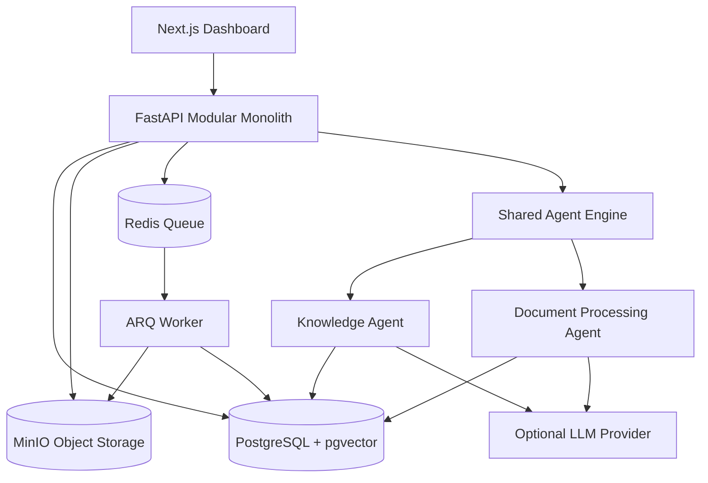

# Personal AI Agent Platform

A local-first, modular-monolith starter for building specialized AI agents. The first working slice includes a **Knowledge Agent**, a **Document Processing Agent**, and the document-ingestion pipeline. It uses FastAPI, Next.js, PostgreSQL with pgvector, Redis, MinIO, and ARQ.

> **Scope note:** this repository is a new personal starter, not a fork of Convozent. It reuses the same broad infrastructure pattern. The Knowledge and Document Processing Agents are registered and executable in this first slice. The other agent directories/modules are intended to be added behind the shared engine as later milestones.

## 1. What works in this starter

- Next.js dashboard with API status, basic metrics, document list, upload form, and a playground for Knowledge and Document Processing agents.
- FastAPI APIs to list/create agents, upload/list/delete/retry documents, execute the Knowledge and Document Processing Agents, view run history, and view dashboard counts.
- MinIO object storage for original uploads.
- ARQ worker consumes document-ingestion jobs from Redis.
- Text extraction for PDF (text-based PDFs), DOCX, TXT, Markdown, and CSV.
- Chunking with overlap, vector generation, and PostgreSQL/pgvector storage.
- Knowledge Agent retrieves nearest chunks and returns source metadata.
- Optional OpenAI-compatible chat completion when `LLM_API_KEY` is configured.
- Alembic initial migration, liveness/readiness endpoints, Docker Compose, and basic tests.

### Important embedding limitation

To make the starter runnable without a paid API key, it uses a deterministic local feature-hashing embedder. This proves the ingestion/retrieval plumbing, but it is **not a semantic embedding model** and will not give production-quality semantic search. Before using real business knowledge, replace `app/services/embeddings.py` with a real embedding provider (and keep the model's dimensions consistent with the pgvector column/migration). Re-index existing documents after changing embedding model or dimensions.

If `LLM_API_KEY` is empty, the Knowledge Agent returns retrieved passages as a preview and the Document Processing Agent returns extracted text rather than pretending to perform structured AI extraction. Add a compatible key/model to enable generated answers and JSON extraction.

## Architecture at a glance



The browser calls FastAPI. FastAPI owns the API, agent registry and execution lifecycle. The ARQ worker processes document files asynchronously. PostgreSQL stores metadata and vectors; MinIO stores the original files; Redis carries background jobs.

## 2. Repository structure

```text
personal-ai-agent-platform/
├── backend/
│   ├── app/
│   │   ├── agents/
│   │   │   ├── base.py                 # Shared agent contract
│   │   │   ├── engine.py               # Common run lifecycle and persistence
│   │   │   ├── registry.py              # Agent kind -> implementation
│   │   │   ├── knowledge/agent.py       # RAG agent
│   │   │   └── document_processing/agent.py # Structured extraction agent
│   │   ├── api/v1/                      # FastAPI route modules
│   │   ├── core/                        # Settings and logging
│   │   ├── db/                          # SQLAlchemy base/session
│   │   ├── models/                      # Agent, run, document, chunk models
│   │   ├── schemas/                     # Pydantic request/response types
│   │   ├── services/                    # Embeddings, storage, extraction, chunking, LLM
│   │   ├── workers/                     # ARQ ingestion task and worker settings
│   │   └── main.py
│   ├── alembic/versions/                # Database migrations
│   ├── tests/
│   ├── Dockerfile
│   └── requirements.txt
├── frontend/
│   ├── src/app/                         # Next.js dashboard
│   ├── src/lib/api.ts                   # Typed API client
│   └── Dockerfile
├── compose.yaml
├── .env.example
└── README.md
```

## 3. Prerequisites

- Docker Engine + Docker Compose plugin (or Docker Desktop on Windows/macOS).
- At least 4 GB RAM recommended for the complete local stack.
- Git (optional but recommended).

## 4. Run locally with Docker

From the repository root:

```bash
cp .env.example .env
```

On Windows PowerShell:

```powershell
Copy-Item .env.example .env
```

Then start the stack:

```bash
docker compose up --build -d
```

Compose starts PostgreSQL/pgvector, Redis, MinIO, a MinIO bucket-init job, FastAPI, the ARQ worker, and Next.js. The backend container runs `alembic upgrade head` before starting Uvicorn. The API creates default `Knowledge Assistant` and `Document Processing Assistant` agents at first startup.

Open:

- Dashboard: http://localhost:3000
- API docs: http://localhost:8000/docs
- API liveness: http://localhost:8000/health/live
- API readiness: http://localhost:8000/health/ready
- MinIO console: http://localhost:9001
  - User: value of `MINIO_ROOT_USER` (default `minioadmin`)
  - Password: value of `MINIO_ROOT_PASSWORD` (default `minioadmin_change_me`)

The host ports are configurable in `.env`. PostgreSQL is mapped to `localhost:5433`, Redis to `localhost:6380`, MinIO API to `localhost:9000`, and MinIO console to `localhost:9001` to reduce conflicts with existing local services.

### Verify containers

```bash
docker compose ps
docker compose logs -f backend
docker compose logs -f worker
```

Check readiness. All three checks should be `true`:

```bash
curl http://localhost:8000/health/ready
```

Expected shape:

```json
{
  "status": "ready",
  "checks": {
    "database": true,
    "redis": true,
    "object_storage": true
  }
}
```

## 5. Try the Knowledge Agent

1. Open http://localhost:3000.
2. Upload a text-based PDF, DOCX, TXT, MD, or CSV file (maximum 20 MB).
3. The document status changes from `uploaded` to `processing` to `ready` (or `failed`).
4. Wait for `ready`, then select either the Knowledge Assistant or Document Processing Assistant in the playground.
5. For Knowledge, enter a question. For Document Processing, choose a ready document and enter extraction instructions.
6. Review retrieved source passages or the structured extraction result.

Without an LLM key, the app shows a retrieval preview. To enable generated answers, set `LLM_API_KEY` and optionally `LLM_BASE_URL` and `LLM_MODEL` in `.env`, then recreate the backend container:

```bash
docker compose up -d --force-recreate backend
```

The LLM integration uses the OpenAI Python client and supports an OpenAI-compatible `LLM_BASE_URL`.

## 6. API examples

List agents:

```bash
curl http://localhost:8000/api/v1/agents
```

Upload a document:

```bash
curl -X POST http://localhost:8000/api/v1/documents \
  -F "file=@./sample.pdf"
```

Run the Knowledge Agent (replace `<AGENT_ID>` with the ID from the agent list):

```bash
curl -X POST http://localhost:8000/api/v1/agents/<AGENT_ID>/runs \
  -H "Content-Type: application/json" \
  -d '{"question":"What are the main points in this document?","top_k":5}'
```

Run the Document Processing Agent (replace IDs with values from `/api/v1/agents` and `/api/v1/documents`):

```bash
curl -X POST http://localhost:8000/api/v1/agents/<DOCUMENT_PROCESSOR_ID>/runs \
  -H "Content-Type: application/json" \
  -d '{"document_id":"<DOCUMENT_ID>","instructions":"Extract invoice number, supplier, invoice date, due date and total amount.","fields":["invoice_number","supplier","invoice_date","due_date","total_amount"]}'
```

List recent runs:

```bash
curl "http://localhost:8000/api/v1/agents/runs?limit=10"
```

## 7. Migrations and tests

Migrations run automatically when the backend container starts. To run them manually:

```bash
docker compose exec backend alembic upgrade head
```

Run backend tests inside the backend container:

```bash
docker compose exec backend pytest -q
```

Run Python static compilation locally (requires Python only):

```bash
python -m compileall backend/app backend/alembic
```

## 8. Document ingestion flow

```text
Browser upload
    -> FastAPI validates file type and size
    -> MinIO stores original object
    -> PostgreSQL stores document row (uploaded)
    -> ARQ job enqueued in Redis
    -> Worker downloads object from MinIO
    -> Extract PDF/DOCX/TXT/MD/CSV text
    -> Chunk text with overlap
    -> Generate vectors
    -> Store chunks + vectors in pgvector
    -> Document status = ready
```

Scanned/image-only PDFs are not OCR'd by this starter. Add an OCR adapter (for example, a managed OCR API or Tesseract worker) if those files must be supported.

## 9. Shared Agent Engine

Every agent should follow the `BaseAgent.execute(db, payload) -> {answer, sources}` contract and be registered in `app/agents/registry.py`. `AgentEngine` owns the common lifecycle: create run record, dispatch implementation, persist result/error, record duration.

A future agent should not create its own web server or container. Add its domain service, schemas, models, and registry entry, then expose it through the same agent-run API or a dedicated domain endpoint where the task needs richer inputs.

Suggested extension sequence:

1. Knowledge Agent: use real embeddings, metadata filters, citations, hybrid search.
2. Document Processing Agent: extraction schemas, field validation, structured JSON, downloadable results.
3. Meeting Intelligence: transcript ingestion, summary, decisions, action items.
4. QA Agent: rubrics, evaluations, scorecards.
5. Research Agent: web search adapter, source capture, citations, report artifacts.
6. Workflow Automation: triggers, nodes, retries, approvals, idempotency.
7. Data Analyst: read-only database connections and SQL guardrails.
8. Procurement/Finance/IT Ops: domain-specific models and approval-controlled integrations.

## 10. Security and production checklist

**This is a local-development starter. Do not expose it to the public internet as-is.** It intentionally has no user authentication or tenant isolation yet.

Before VPS deployment:

- Add authentication (OIDC/session/JWT) and role-based authorization.
- Add `organization_id` or owner scoping to every tenant-owned table and every query.
- Store provider credentials encrypted; never return secrets to the browser.
- Add upload malware scanning and stronger content validation.
- Add request rate limits, per-user quotas, and maximum execution budgets.
- Restrict document access and use short-lived presigned download URLs.
- For Data Analyst, use a dedicated read-only database credential, table allowlists, statement timeouts, and SQL parsing/validation.
- Require human approval for payments, purchase orders, destructive IT actions, or other external side effects.
- Add structured logs, error monitoring, metrics, and audit events.
- Put Caddy/Nginx/Traefik in front for HTTPS; do not publish Postgres, Redis, or MinIO admin ports publicly.
- Use strong unique passwords, secrets manager/environment injection, encrypted backups, and tested restore procedures.
- Pin MinIO image versions rather than `latest` for reproducible deployments.
- Add backup/retention policies for PostgreSQL and MinIO.

### Using an existing PostgreSQL / Redis / MinIO installation

The default Compose file provides local instances so the starter can run as a self-contained development stack. If you already have these services, edit `compose.yaml` to remove/disable the `postgres`, `redis`, `minio`, and `minio-init` services and their `depends_on` entries. Then set `DATABASE_URL`, `REDIS_URL`, `S3_ENDPOINT_URL`, and the storage credentials in `.env` to endpoints reachable from the app containers. Ensure all services share a Docker network. Do not use `localhost` to refer to a host service from inside a container; use a routable host name or `host.docker.internal` where supported.

## 11. Useful commands

```bash
# Start

docker compose up --build -d

# Stop (keeps persistent volumes)
docker compose down

# Stop and DELETE all local DB, Redis and MinIO data (destructive!)
docker compose down -v

# Follow all logs
docker compose logs -f

# Rebuild only API and worker
docker compose build backend worker && docker compose up -d backend worker

# Shell into API container
docker compose exec backend sh
```

## License / ownership

This starter is generated for your personal project. Review dependency licenses and your provider terms before commercial deployment.
